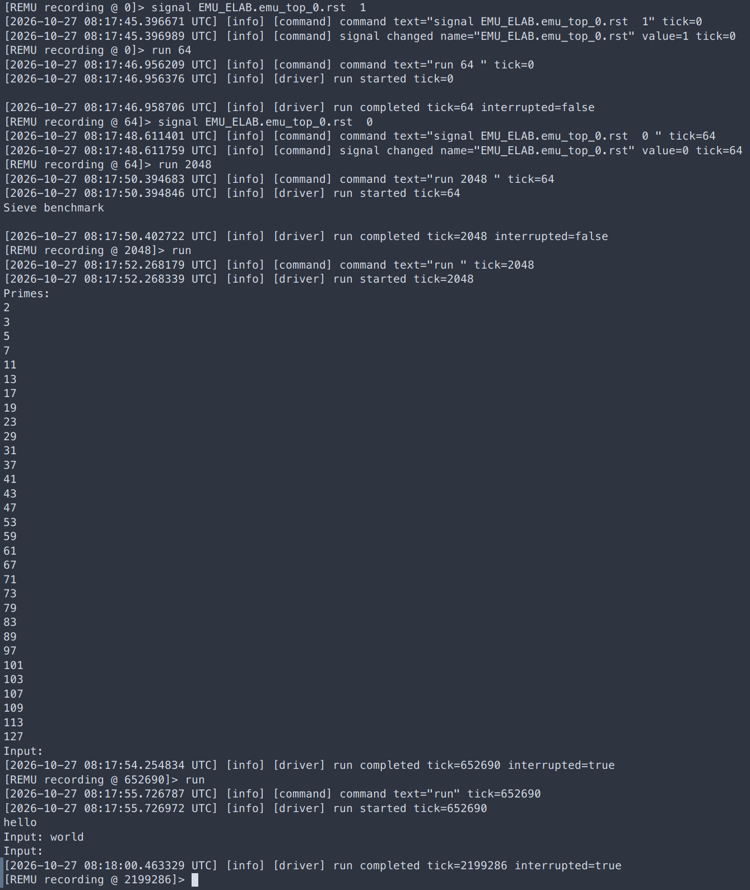
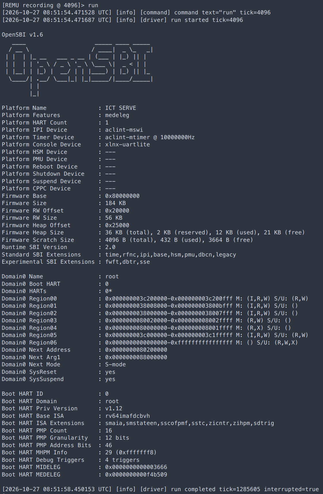
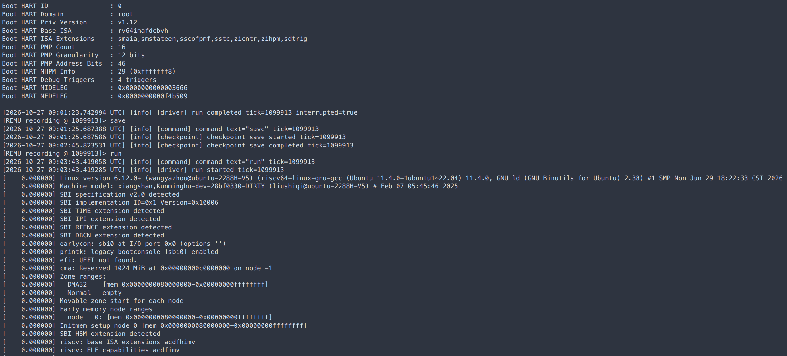

# 双FPGA工作负载运行记录

## 1. 本次材料与状态

整理日期：2026-10-27。本文记录作者补充的实验说明、本地裸机程序源码及已提供的三张运行截图。本地整理基于主仓库`thesis`分支、论文仓库`main`分支；程序代码核对不等于重新执行实验，当前源码与实际板级镜像的精确构建版本仍待补为x。

| 对象 | 本次补充内容 | 证据及当前边界 |
| --- | --- | --- |
| PicoRV32 | 手写裸机程序，打印名称、计算素数、执行Echo交互 | 已有代码与双FPGA运行截图，可见素数输出及交互过程 |
| Rocket | 使用同一目录下的手写裸机程序 | 程序来源由作者确认；本批尚未提供Rocket运行图片/原始日志 |
| KMH（单核） | OpenSBI v1.6；Linux基础版本6.12.0，截图内核版本串为`6.12.0+` | 已有OpenSBI、暂停保存及后续Linux早期启动记录；本次运行进入CLI的过程仍在进行 |

本批记录与此前作者确认的历史功能状态分开：当前KMH截图不能作为这一次Linux已进入CLI的证据，也不据此否定其他历史运行结果。Nanhu本轮没有新增材料。

## 2. PicoRV32与Rocket的裸机工作负载

### 2.1 程序来源与执行顺序

作者确认，两个DUT使用手动编写的裸机测试程序，源码位于[examples/workload/baremetal/](../../examples/workload/baremetal/)。它是功能测试负载，不将输出字符串中的“benchmark”解释为已有标准基准分数或性能排名。

| 源码 | 与实验相关的行为 |
| --- | --- |
| [main.c](../../examples/workload/baremetal/main.c) | 依次调用`run_sieve()`、`run_echo()` |
| [sieve.c](../../examples/workload/baremetal/sieve.c) | 输出`Sieve benchmark`和`Primes:`；以`N=128`筛选并逐行打印满足`2≤p<128`的素数 |
| [echo.c](../../examples/workload/baremetal/echo.c) | 每轮输出`Input: `，接收到换行后回送该行字符；循环最多10轮 |
| [print.c](../../examples/workload/baremetal/print.c) | 经UART状态和收发寄存器完成字符输入输出，无输入时等待接收数据 |
| [start.S](../../examples/workload/baremetal/start.S) | 设置栈、进入`main`，返回后执行`ebreak` |
| [Makefile](../../examples/workload/baremetal/Makefile) | 构建裸机ELF、BIN等产物；实际编译参数还受各DUT配置影响 |

预期流程为：**打印名称→筛选并打印素数→等待输入并回显**。停在`Input:`且没有用户输入时属于程序预期的交互等待，不是自行退出；当前代码也不是无限Echo，完成10轮后才返回。本批截图没有证明10轮均已执行完毕。

### 2.2 预期素数输出

根据当前程序，预期输出31个小于128的素数，依次为：

```text
2, 3, 5, 7, 11, 13, 17, 19, 23, 29, 31,
37, 41, 43, 47, 53, 59, 61, 67, 71, 73,
79, 83, 89, 97, 101, 103, 107, 109, 113, 127
```

这里为便于阅读使用逗号排列；实际程序逐行输出，每个数字后跟换行。Echo部分的预期是按行接收并原样回送输入（包括换行），具体测试输入随运行记录填写，而不是固定为某个字符串。

### 2.3 PicoRV32双FPGA运行记录



图中可直接观察到：

- 复位信号置1，运行至tick 64后释放复位；随后执行`run 2048`并输出`Sieve benchmark`。
- 后续运行输出`Primes:`及上述31个素数，目视核对与预期列表一致，随后出现`Input:`。
- 交互区可见`hello`、`world`和后续`Input:`提示；结合作者说明记录为Echo交互结果。本次未对UART收发流进行自动逐字符比对，不用截图推断全部交互覆盖。
- Driver记录了运行被中断后的tick，例如652690和2199286。它们是相应暂停时的逻辑周期位置，不是程序自然结束周期；含人工输入与暂停的窗口不直接用于计算持续运行频率。

`run 2048`按Driver目标周期语义记录为运行至tick 2048，不写成从tick 64再执行2048个周期。截图支持该负载的可观察功能结果，不替代单体RTL与分区执行的周期级事件或内部状态比较。

### 2.4 Rocket记录范围

作者确认Rocket的裸机程序同样来自上述目录；此前已确认裸机运行正常。本轮新增的是程序来源及预期行为，不能将PicoRV32截图作为Rocket实际输出记录。

Rocket实际输出/截图路径x、具体输入x、执行周期范围x、镜像与bitstream版本x，待后续材料补充。

## 3. KMH的OpenSBI、暂停保存与Linux启动

### 3.1 软件版本与OpenSBI输出

| 项目 | 本次记录 |
| --- | --- |
| DUT | 香山KMH，单核 |
| 固件 | OpenSBI v1.6，作者确认且截图可见 |
| Linux | 作者给出的基础版本为6.12.0；截图原始版本串为`Linux version 6.12.0+`，保留`+`以便后续定位构建 |
| OpenSBI截图中的HART数 | `Platform HART Count : 1` |
| OpenSBI截图中的平台名称 | `ICT SERVE` |
| Linux完整镜像、配置及rootfs | x |



OpenSBI截图显示固件版本、平台与Boot HART信息，末尾Driver报告`run completed tick=1285605 interrupted=true`。它记录一次手动停止的位置，不是Linux启动完成标记。

### 3.2 手动暂停、保存检查点、继续运行Linux

作者说明：运行完OpenSBI后，手动暂停并保存检查点，然后继续运行Linux。下图中的日志展示了暂停、`save`完成、再`run`及Linux早期启动这一顺序。



从这张截图转录的关键日志如下，时间均为2026-10-27 UTC：

| 事件 | 日志时间 | 逻辑周期/内容 |
| --- | --- | --- |
| 运行被中断 | 09:01:23.742994 | `run completed tick=1099913 interrupted=true` |
| 发出保存命令 | 09:01:25.687388 | `command text="save" tick=1099913` |
| 开始保存 | 09:01:25.687586 | `checkpoint save started tick=1099913` |
| 保存完成 | 09:02:45.823531 | `checkpoint save completed tick=1099913` |
| 再次运行 | 09:03:43.419285 | `run started tick=1099913` |
| 后续可见输出 | Linux自身的早期启动日志 | `Linux version 6.12.0+`、SBI扩展检测、早期控制台及内存布局等 |

保存开始与完成的日志时间戳差为**80.135945 s（约80.136 s）**。这是从图片转录并相减得到的单次日志间隔，不是重复实验均值，不含前面的暂停等待，也不含保存后人工等待再次`run`的时间。检查点大小、具体输出路径、分段耗时与原始文本日志仍为x；在这些条件补齐前，不据此计算传输带宽或代表所有KMH配置的保存性能。

后续提供的[性能摘录整理](board-performance.md)已补充对应保存操作的Profiler记录：total为80.1357 s，design state为0.185341 s，memory为79.9447 s，并附内存字节统计。图片外围日志时间戳与内部Profiler起止范围不同，两种数值分别保留，不作为两次独立实验平均；完整原日志、文件大小及具体路径仍待补。

两张KMH图片中的停止tick分别为1285605与1099913，尚未建立它们的同一运行会话关系，因此分别归档，不拼接为一条tick连续递增的时间线。暂停保存及继续运行的顺序直接以第二张图为依据。

图中的`run`是在保存后继续执行，未显示重新加载检查点。因此该图支持“暂停→保存→继续运行Linux”，**不单凭此图宣称完成了Restore或从检查点Replay**。同样，单个Driver tick不替代各Part屏障计数及暂停状态对照；一致暂停专项记录仍需另附。

### 3.3 当前Linux进度

作者最新说明：本次Linux进入CLI的过程仍在运行中。当前图片只有内核早期启动输出，没有登录/命令行提示符和用户命令执行结果。

当前可写入报告的阶段性表述是：**KMH双FPGA系统运行OpenSBI v1.6，并在手动暂停保存检查点后继续进入Linux 6.12.0+的早期启动过程；该次运行的CLI结果待补。**

CLI截图/文本日志x、到达CLI的逻辑周期x、定义明确起止点的启动耗时x、实际命令及输出x，取得后再更新本记录。

## 4. 报告使用位置与后续补充

| 位置 | 本批可用材料 | 仍需保留的边界 |
| --- | --- | --- |
| 1.6 DUT与工作负载 | PicoRV32/Rocket手写裸机负载；KMH OpenSBI与Linux版本 | 实际构建版本与配置待补x |
| 1.6裸机运行 | PicoRV32素数与Echo截图 | Rocket本批无独立输出记录；PicoRV32未展示10轮完成或自然退出 |
| 1.6操作系统运行 | KMH OpenSBI信息与Linux早期启动图 | 本次CLI仍在运行，不预写成功 |
| 1.6暂停与检查点 | KMH在tick 1099913的暂停、保存完成与继续执行顺序 | 不替代分区状态对照或Restore/Replay验证 |
| 1.6状态管理开销 | 单次保存日志间隔约80.136 s | 需补检查点大小、配置和原始日志；不当作平均值或带宽 |

本轮仅更新实验材料及图片索引，不改报告正文或旧大纲，不修改程序或原始图片，不重跑实验。后续写入1.6/1.7时，应将本批最新进度与此前历史结果的配置和来源分别说明，避免把不同测试批次混为一次完整验证。
