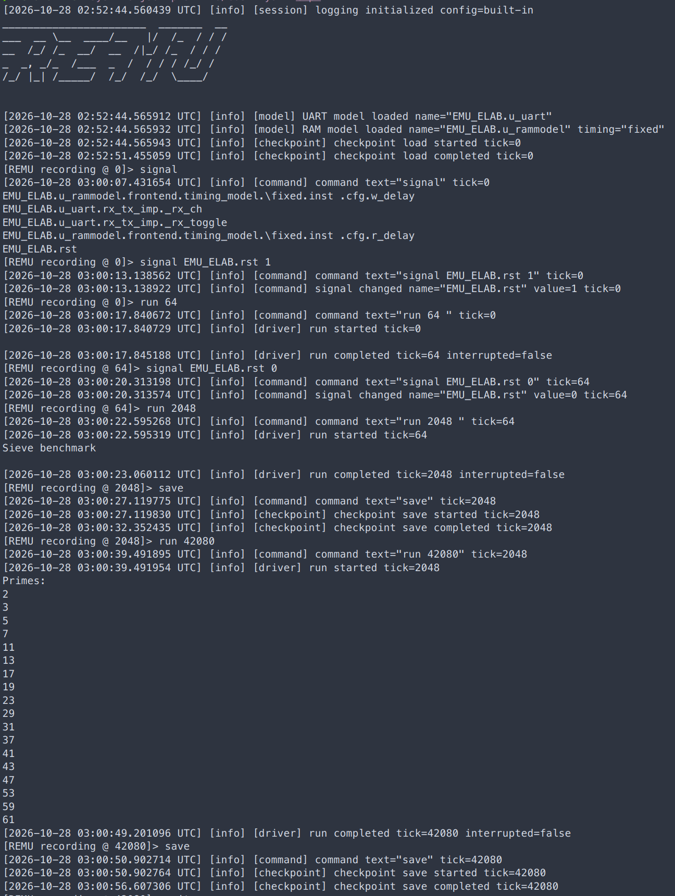
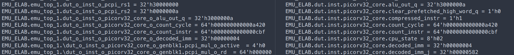

# PicoRV32单Part与双Part Cosim同周期执行及暂停状态对照

## 1. 实验目的与材料

本案例比较同一PicoRV32裸机负载在单Part与双Part Cosim中的可观察输出，以及两者在DUT逻辑周期42080处保存的检查点。它为划分后的执行和全局暂停增加了参考对照：不仅检查双Part最终报告了哪个周期，还检查该周期的选定内部寄存器值是否与单Part执行一致。

- 整理日期：2026-10-28；运行截图中的日志时间为UTC。
- 单Part参考：作者所称“单板Cosim”，本文统一写为单Part Cosim，不指物理单FPGA上板。
- 双Part对象：上一例已确认的双Part Cosim运行，在全局暂停后停于42080周期；见[非零检查点重放案例](picorv32-cosim-replay.md)。
- 工作负载：手工编写的baremetal程序，先执行素数筛选，再进行Echo。两种配置的串口输出一致由作者确认；截图可直接核对的范围见下文。
- 新增图片：[单Part运行记录](figure/picorv32-cosim-1part-run-checkpoint.png)、[单Part与双Part检查点对照](figure/picorv32-cosim-1part-vs-2part-state-tick42080.png)。原图保持不变。
- 本文以作者说明及图片中的可见结果为依据，未重新运行Cosim，也未读取完整检查点进行自动化全状态比较。整理时主仓库为`vivado2024.2`、论文仓库为`main`，不以此替代实验构建版本。

## 2. 单Part参考执行及与双Part的周期对齐



单Part截图中的操作与结果依次为：

| 阶段 | 操作 | 日志可见结果 |
| --- | --- | --- |
| 初始状态 | 加载初始检查点，设置`EMU_ELAB.rst=1` | 起始tick为0 |
| 复位 | `run 64` | 运行至64，`interrupted=false` |
| 释放复位 | 设置`EMU_ELAB.rst=0`，执行`run 2048` | 运行至2048，输出`Sieve benchmark` |
| 保存中间状态 | `save` | `checkpoint save completed tick=2048` |
| 运行至比较周期 | `run 42080` | 输出`Primes:`及素数前缀；`run completed tick=42080 interrupted=false` |
| 保存比较状态 | `save` | `checkpoint save completed tick=42080` |

Driver的`run <tick>`指定绝对目标周期，见[命令实现](../../driver/cmd.cc)。因此第二段从64运行至2048，推进1984周期；最后一段从2048运行至42080，推进40032周期，不能将两条命令参数直接当作新增周期数。

此前双Part运行使用相同的64周期复位及2048周期中间检查点，随后继续执行，通过全局暂停停在42080周期并保存。双Part截图为`interrupted=true`，本次单Part则通过指定目标周期自动停止。两种停止方式不同，但用于比较的Driver逻辑周期均为42080。

两张运行图均显示`Sieve benchmark`，随后显示`Primes:`及以下18个素数：

```text
2, 3, 5, 7, 11, 13, 17, 19, 23,
29, 31, 37, 41, 43, 47, 53, 59, 61
```

该可见前缀在两种配置下相同，也符合程序预期。图片没有展示本次两条参考执行都已输出全部31个素数、完成Echo或自然退出；这里不将作者确认的输出一致扩大为已归档完整UART文本的自动逐字符比较。程序输出与内部状态对照也属于不同强度的证据，不能相互替代。

## 3. 检查点层次映射与寄存器对照



依据作者说明，图左为双Part、图右为单Part在42080周期的检查点解码结果。层次路径分别为：

| 对象 | 截图中的路径前缀 |
| --- | --- |
| 单Part处理器核 | `EMU_ELAB.dut.inst.picorv32_core.` |
| 双Part中Part 1的处理器核状态 | `EMU_ELAB.emu_top_1.dut_0_inst_0_picorv32_core_0_` |

作者说明，自适应划分会选择性展开原始层次，并将单元重新打包到各Part，因此同一逻辑寄存器在划分后可以具有不同的层次名称。上述前缀分别接下表的寄存器名，构成本例实际对照的完整路径。例如：

```text
单Part：EMU_ELAB.dut.inst.picorv32_core.alu_out_q
双Part：EMU_ELAB.emu_top_1.dut_0_inst_0_picorv32_core_0_alu_out_q
```

比较应根据状态映射和原始逻辑对象确定对应关系，再核对位宽及数值；不能要求两侧路径字符串完全相同，也不能仅因两个无关对象的数值碰巧相同就认定映射成立。本例对应关系由作者确认，截图可核对名称与数值，完整映射元数据仍可随构建产物归档。

图中两侧**共同可见**的四项寄存器如下，十六进制值保留截图位宽并统一大小写：

| 逻辑寄存器 | 位宽/bit | 单Part检查点值 | 双Part检查点值 | 目视结果 |
| --- | ---: | --- | --- | --- |
| `alu_out_q` | 32 | `32'h3000000a` | `32'h3000000a` | 一致 |
| `count_cycle` | 64 | `64'h000000000000a420` | `64'h000000000000a420` | 一致 |
| `count_instr` | 64 | `64'h0000000000000cbf` | `64'h0000000000000cbf` | 一致 |
| `decoded_imm` | 32 | `32'h00000004` | `32'h00000004` | 一致 |

双Part侧还显示PCPI操作数及部分乘法器状态，单Part侧还显示处理器控制和译码状态；由于本图没有同时显示它们各自对应的另一侧值，本文不将这些额外行计入已复核的四项对照。

### DUT内部周期计数与Driver tick的区别

`count_cycle`是PicoRV32自身的计数寄存器，而42080是Driver记录的DUT逻辑周期位置，两者不是同一个计数器。本图中的`0xa420`为十进制42016，满足：

```text
42080 - 64 = 42016 = 0xa420
```

这与前64周期保持复位、此后释放复位的操作相符。当前[PicoRV32源码](../../examples/design/picorv32/verilog/picorv32.v)在计数器启用时按`count_cycle <= resetn ? count_cycle + 1 : 0`更新，可解释复位期间DUT内部计数被清零、Driver逻辑周期仍推进的区别。代码用于说明这一计数语义，不替代实际镜像版本的核对；不能把截图中的`count_cycle`改写成42080。

## 4. 与上一例软件重放证据的关系

这次新增的单Part参考与上一例非零检查点重放回答不同问题：

| 比较 | 对照点 | 当前可见结果 |
| --- | --- | --- |
| 单Part Cosim与双Part Cosim的程序执行 | 相同复位流程及截至42080周期的截图输出 | 名称和素数前缀相同 |
| 单Part Cosim与双Part暂停检查点 | 两者绝对周期42080 | 四个选定对应寄存器值一致 |
| 双Part后续检查点与从2048恢复的软件RTL重放 | 绝对周期42080，对应重放相对周期40032 | 上一例六个选定信号值一致 |

两份案例构成互补的验证材料：单Part参考用于检查划分执行和暂停后的选定状态，早期检查点的软件重放用于检查恢复后能否重现后续行为。`alu_out_q=32'h3000000a`在三条路径的图示对照中均出现，可作为共同观察点；但两份表的信号集合并不完全相同，不能将四项与六项直接合并成十项三方一致，更不能推导整个区间所有状态均相同。

## 5. 阶段性结论与报告表述

本案例为同周期执行和暂停状态提供了具体对照：在所测试PicoRV32裸机负载中，单Part与双Part Cosim的截图可见串口输出一致；在42080周期，两种配置检查点中的四个选定对应寄存器值一致。这支持双Part执行及其全局暂停在已比较范围内保持了与单Part参考相同的逻辑状态，而不只停在相同的计数值。

可用于中期报告1.2、1.3或1.6的表述为：

> 以PicoRV32裸机程序为对象，分别进行单Part与双Part Cosim。两种配置均保持复位64周期后释放复位，运行至2048周期，再继续执行至42080周期。单Part通过指定目标周期停止，双Part通过全局暂停停止，两者均在该周期保存检查点。串口截图中的程序名称和素数输出前缀一致。根据原始逻辑对象对齐层次展开及重新打包后的状态名称，比较`alu_out_q`、`count_cycle`、`count_instr`和`decoded_imm`，四项寄存器值均相同。该结果为划分执行与一致暂停后的选定状态正确性提供了参考对照，不等于全部内部状态或所有逻辑周期均已逐位验证。

该实验是Cosim对照，不是物理单板与双板比较；同周期四项寄存器一致也不等于形式化等价证明、完整寄存器/SRAM比较，或每一周期的事件对照。各Part进入屏障的进度、共同目标及最终计数仍应由完整暂停日志单独呈现。

## 6. 可补充的复现材料与原图标识

后续归档单Part与双Part的RTL/工具构建标识、初始内存与输入配置、42080周期实际检查点、状态映射元数据及解码命令，即可使他人直接复查路径和数值。若要扩大状态或周期覆盖，应进一步提供实际比较清单与自动比较结果，而不由当前截图外推。

| 原图 | SHA-256 |
| --- | --- |
| `figure/picorv32-cosim-1part-run-checkpoint.png` | `cf0c0c6808bfe6ed8568e6fbe73fb4bc120fadcfb2c945ca4660ac9bfcb6772c` |
| `figure/picorv32-cosim-1part-vs-2part-state-tick42080.png` | `c3bfefacc699fafa301e6428c834d4a36eb9ffd61514c758cf7f024c33bf2c0d` |

本次仅整理实验材料并更新索引和案例间引用，未修改TeX正文、程序、原图或已有原始日志，未重新执行实验。
