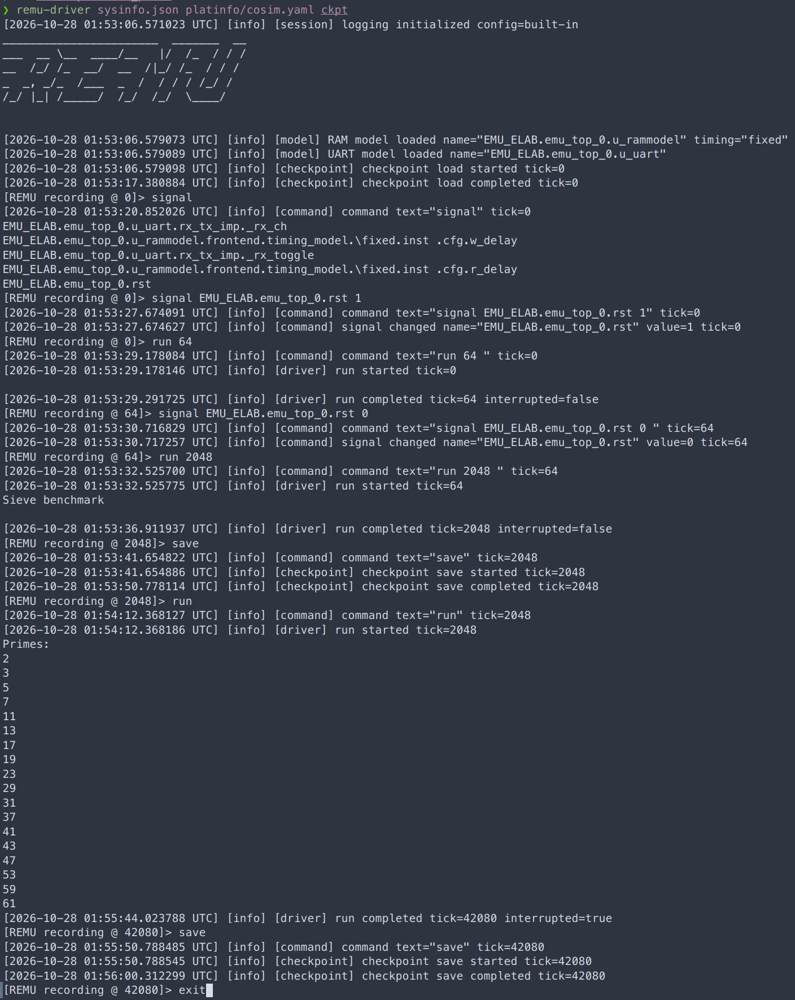
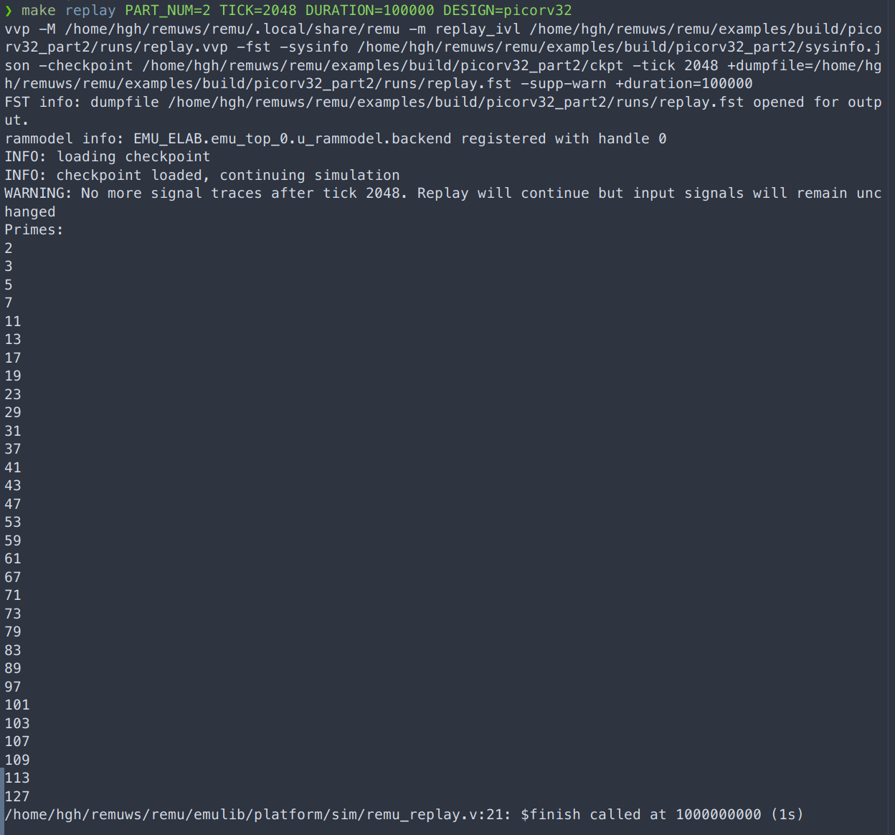
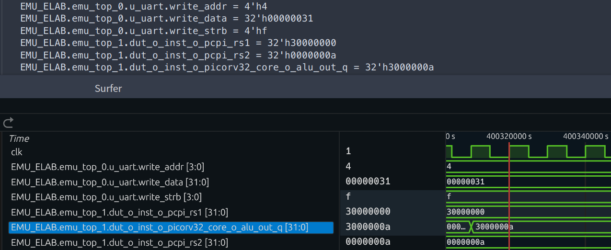

# PicoRV32双Part Cosim非零检查点与软件RTL重放案例

## 1. 实验目标与材料来源

本案例检查：从双Part执行在非零逻辑周期保存的检查点恢复软件RTL模型后，继续执行能否在后续同一DUT逻辑周期得到与参考执行一致的选定内部信号值。它将检查点保存、软件状态加载、继续执行及后续状态比较连接起来，不只检查加载命令是否正常返回。

- 整理日期：2026-10-28；截图中的Driver时间戳为当日UTC。
- DUT：PicoRV32，划分为两个Part；负载为手工编写的baremetal程序，依次执行素数筛选和Echo，参见[负载说明](board-execution.md#2-picorv32与rocket的裸机工作负载)。
- 参考环境：**双Part Cosim**，由作者本轮确认；启动截图也显示`platinfo/cosim.yaml`。本案例不记为物理双FPGA上板实验。
- 重放环境：Icarus Verilog的`vvp`及`replay_ivl`模块；生成FST波形，截图使用Surfer查看。
- 材料：作者操作说明与三张截图。本文数值是对截图的人工转录、目视比较及周期换算，未重新运行Cosim或Replay，未对原始检查点、FST进行自动化比较。
- 整理时主仓库为`vivado2024.2`，论文仓库为`main`；这不是实验二进制或RTL的精确构建版本证明。

## 2. 实验流程与周期对应

参考执行从初始状态运行；软件重放则从参考执行保存的2048周期检查点重新开始。两条路径在绝对逻辑周期42080处比较：

| 步骤 | 参考执行或软件重放操作 | DUT绝对逻辑周期 |
| --- | --- | ---: |
| 1 | 双Part Cosim中复位置1，执行`run 64` | 0→64 |
| 2 | 释放复位，执行`run 2048`，随后`save` | 64→2048；保存起点检查点 |
| 3 | 参考执行继续`run`，全局暂停后再次`save` | 2048→42080；保存比较目标检查点 |
| 4 | 软件RTL加载2048周期检查点，设置重放长度100000周期 | 起点2048；覆盖目标42080 |
| 5 | 在重放的相对周期40032处，比较波形与42080周期检查点解码值 | 2048+40032=42080 |

`run 2048`表示运行到绝对tick 2048，不是从64再增加2048周期。因此复位释放后的这一段推进1984周期。用于最终比较的相对周期为：

```text
T0 = 2048
T1 = 42080
ΔC = T1 - T0 = 40032
```

这里的40032是恢复起点之后经过的DUT逻辑周期数，不是另一个检查点编号，也不是Host时间。

## 3. 三张图片及可复核内容

### 3.1 双Part Cosim参考执行与两次保存



图片中的启动命令为：

```text
remu-driver sysinfo.json platinfo/cosim.yaml ckpt
```

随后依次显示复位、运行至64、释放复位、运行至2048、保存检查点、继续执行，以及在42080周期中断运行后再次保存。两次均可见对应tick的`checkpoint save completed`。

2048周期之前出现`Sieve benchmark`，继续运行后出现`Primes:`和2至61的素数前缀，内容与程序预期一致。截图在42080周期暂停，没有显示本次参考执行已输出全部31个素数或完成Echo，因此不将其写成整个裸机程序自然结束。

作者确认42080周期的停止使用全局暂停。该图直接显示最终Driver tick和随后保存的顺序，但未展开各Part的屏障进度、目标与最终计数；不能仅由该图列出这些未显示的寄存器值。

### 3.2 从2048周期检查点进行软件RTL重放



截图中的命令为：

```text
make replay PART_NUM=2 TICK=2048 DURATION=100000 DESIGN=picorv32
```

实际展开的`vvp`命令包含`-m replay_ivl`、`-tick 2048`、`+duration=100000`及FST输出路径；后续显示：

```text
INFO: loading checkpoint
INFO: checkpoint loaded, continuing simulation
WARNING: No more signal traces after tick 2048. Replay will continue but input signals will remain unchanged
```

随后重放打印`Primes:`及2至127的31个素数，末尾由`remu_replay.v`调用`$finish`。这里的结束来自指定重放长度，而非裸机程序自然退出。参考运行截图中的素数前缀与重放输出相符，但两图执行区间不同，不能宣称两段完整UART输出已逐字符自动比对。

输入警告说明本次所用记录在2048之后没有新的输入变化可回放，仿真继续保持输入值。该案例不作为变化外部输入、Echo交互或所有环境行为均已正确重放的证据；还需保留实际输入记录，才能进一步核对比较区间内的完整输入条件。

截图显示的波形产物为：

```text
/home/hgh/remuws/remu/examples/build/picorv32_part2/runs/replay.fst
```

这是截图中的运行环境路径，本次未复制该FST，也不据此推定实验服务器就是此前采集划分数据的`serve41`。

### 3.3 后续同周期的检查点与波形比较



图的上半部分是作者从42080周期检查点取得的解码值，下半部分是重放波形中的对应信号。作者选取相对周期40032，因此对应DUT绝对周期42080。

当前源码[replay/replay_ivl.cc](../../replay/replay_ivl.cc)将重放逻辑周期设置为`init_tick + time / period`，其中`period=10000`。图中游标附近的原始时间刻度400320000与`40032×10000`一致，可辅助核对上述换算。波形界面时间单位不应直接解释为真实经过的秒数，或用于计算Host运行频率；原始FST的timescale和游标采样相位仍宜随文件归档。

以下逐项转录截图。所有层次均以`EMU_ELAB`为根；波形侧按截图中的十六进制显示补齐位宽，以便比较。

| 层次 | 信号 | 检查点解码值 | 重放波形值 | 目视结果 |
| --- | --- | --- | --- | --- |
| `emu_top_0.u_uart` | `write_addr` | `4'h4` | `4'h4` | 一致 |
| `emu_top_0.u_uart` | `write_data` | `32'h00000031` | `32'h00000031` | 一致 |
| `emu_top_0.u_uart` | `write_strb` | `4'hf` | `4'hf` | 一致 |
| `emu_top_1` | `dut_0_inst_0_pcpi_rs1` | `32'h30000000` | `32'h30000000` | 一致 |
| `emu_top_1` | `dut_0_inst_0_pcpi_rs2` | `32'h0000000a` | `32'h0000000a` | 一致 |
| `emu_top_1` | `dut_0_inst_0_picorv32_core_0_alu_out_q` | `32'h3000000a` | `32'h3000000a` | 一致 |

这六项覆盖两个Part层次中的UART接口信号与处理器数据通路信号，并非六项都被独立证明为扫描寄存器，不能由该表推出所有寄存器和SRAM都已逐位比较。截图中的`clk`用于观察采样位置，不计入上述六项检查点对照。

## 4. 阶段性结论及报告可用表述

本案例支持以下结论：双Part Cosim在非零周期2048保存的分区检查点能够被Icarus Verilog重放环境加载并用于后续执行；在所比较的绝对周期42080，两个Part层次中的六个选定信号值与参考执行在该周期保存的检查点解码值一致。相比“保存后直接继续run”，本案例提供了从早期检查点重新加载、跨越后续执行区间、再进行同周期比较的具体证据。

可用于中期报告1.3或1.6的正文表述为：

> 以PicoRV32裸机程序为对象，在双Part Cosim中复位64周期后运行至逻辑周期2048，并保存用于软件重放的检查点。参考执行继续推进，在全局暂停后的周期42080再次保存检查点。随后，Icarus Verilog从2048周期检查点恢复并重放100000个周期。在重放的相对周期40032处，将两个Part层次中的UART接口和处理器数据通路信号与42080周期检查点的解码值比较，所选六项数值均一致。该结果为非零检查点的软件RTL恢复、后续执行及同周期选定信号一致性提供了阶段性验证，不等同于全部状态或整个重放区间已经逐周期比较。

本例不证明物理双FPGA恢复、FPGA端重新加载检查点、全部内部状态等价或整个100000周期区间无差异。42080检查点是同一分区参考执行的后续状态，不是未划分RTL的独立参考；因此也不单独证明划分前后等价。

后续新增的[单Part与双Part同周期状态对照](picorv32-cosim-cycle-state.md)补充了单Part参考，在42080周期对四个对应寄存器进行比较。本例的早期检查点重放与该参考对照分别归档；两者观察集合不同，共同可见的`alu_out_q`可作为连接点，不合并宣称所有信号均已三方比较。

## 5. 后续归档材料

为便于他人直接重跑及自动核验，可继续补充：

- 实验DUT、生成RTL、`sysinfo.json`与工具构建版本，Icarus Verilog版本及Cosim配置。
- 2048和42080两份实际检查点及对应输入轨迹、目录索引或校验值。
- 完整Driver日志，特别是42080暂停前各Part的进度、目标、步数和最终计数。
- 42080检查点的解码命令、输出全文，以及原始`replay.fst`、timescale和游标定位方式。
- 若扩大结论，另做更广状态集合或多周期自动比较；本次六项目视一致不能直接代替这些实验。

上述缺项属于复现材料和覆盖范围补充，不否定截图已展示的加载、继续执行和六项数值一致。它们也不要求将本次功能案例重新包装为性能实验。

## 6. 原图标识与本次整理范围

| 原图 | SHA-256 |
| --- | --- |
| `figure/picorv32-cosim-2part-run-checkpoint.png` | `5ecd9053fc4ee05e58f60d8bb31c735d0af13dd9f2d615cdb5e789e4d56c9162` |
| `figure/picorv32-rtl-replay-from-tick2048.png` | `926594ea0a59c9a04bec19c4db4cec526feb122f2768ef46081ca0fba3a54960` |
| `figure/picorv32-cosim-vs-replay-state-tick42080.png` | `3708fc4d0f9cf3cc644ffc5d11d61c2fa2b5cc905393f4445201878a0b17d2c0` |

本次仅新增实验文字归档并更新索引，保留原图文件名和内容；未修改TeX正文、代码或既有原始日志，未执行新的仿真或板级实验。
